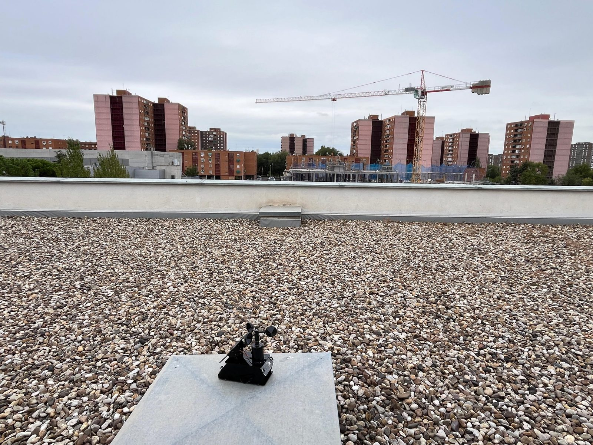
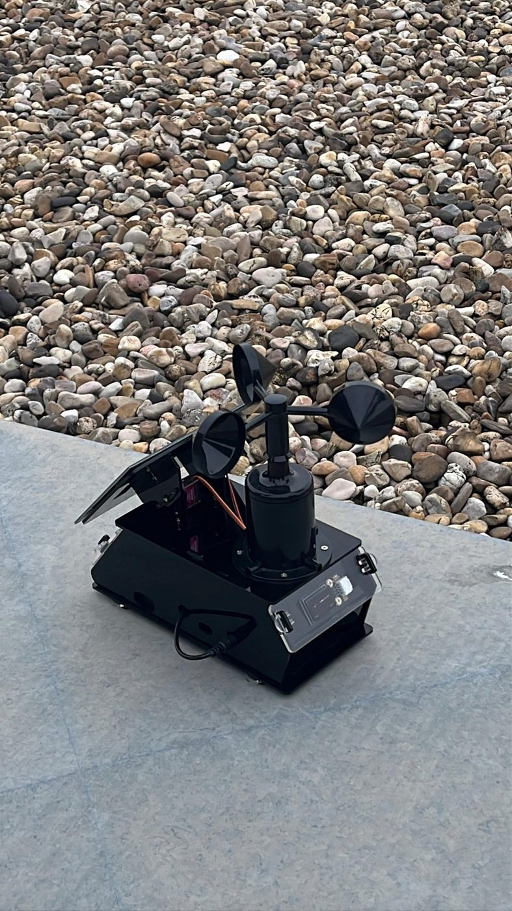
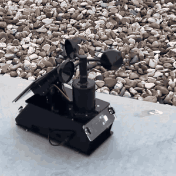
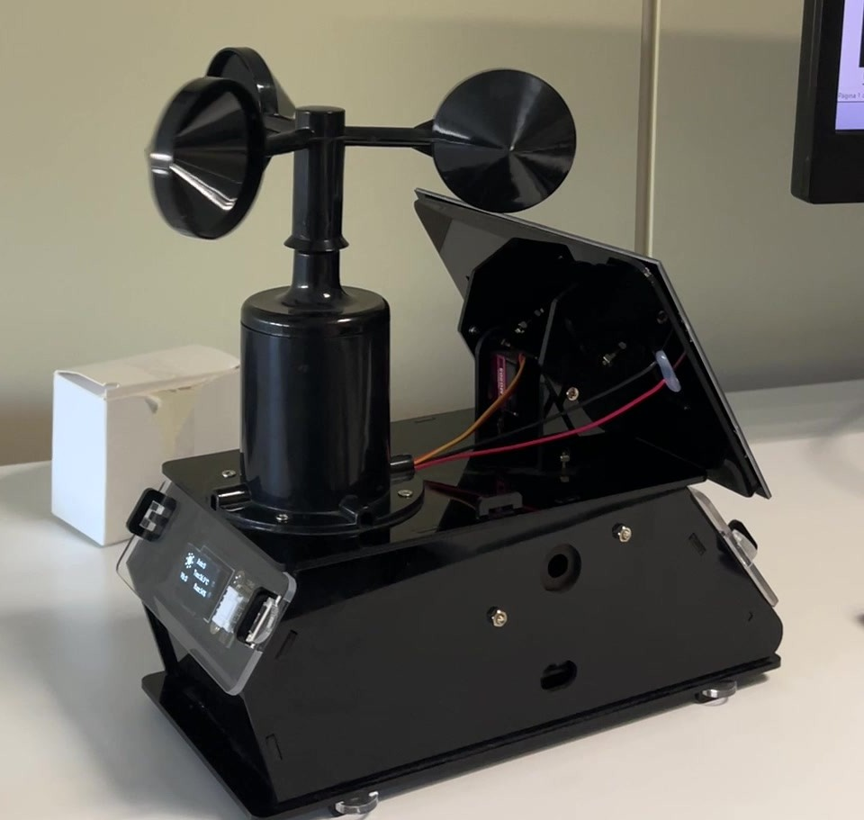
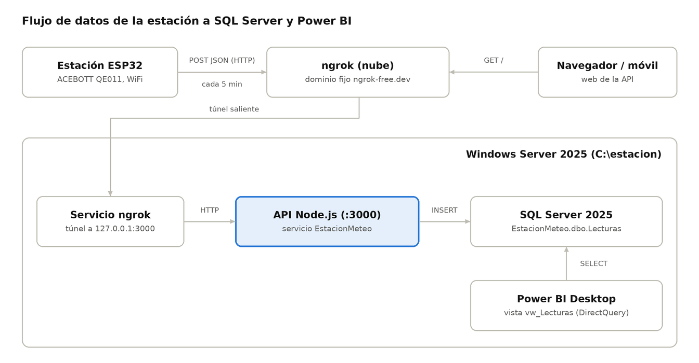
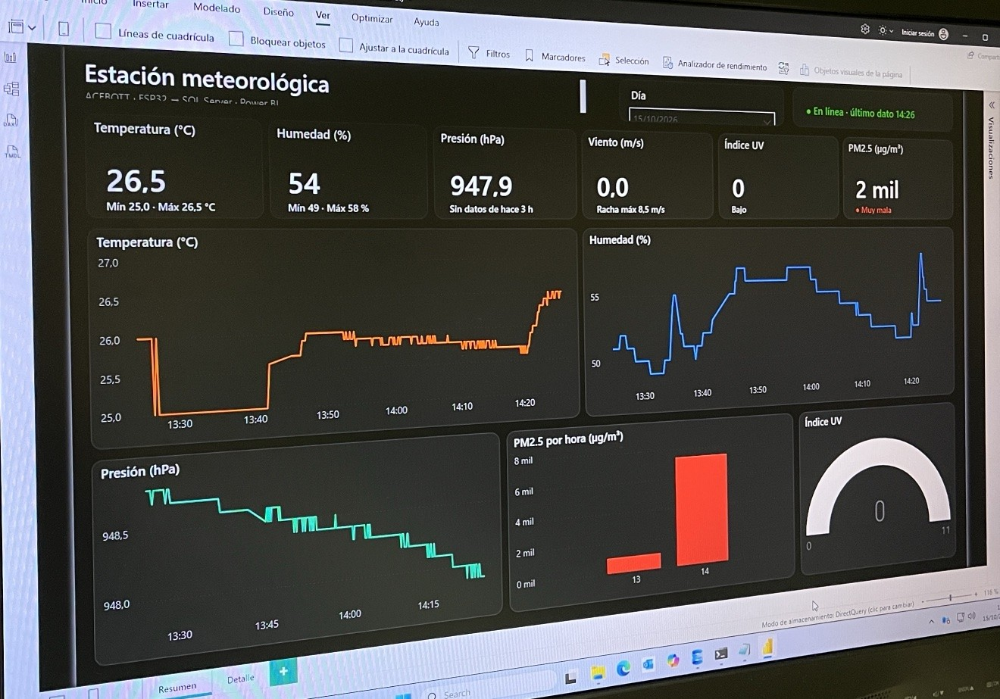
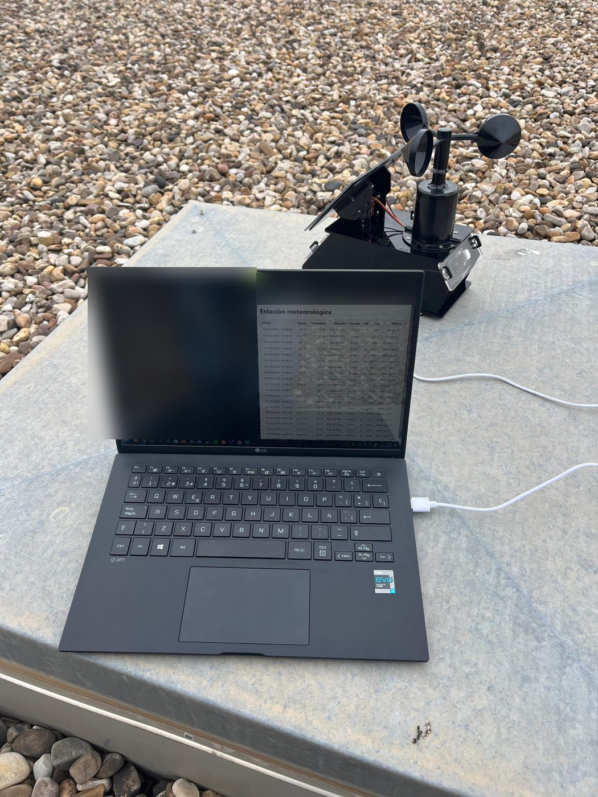
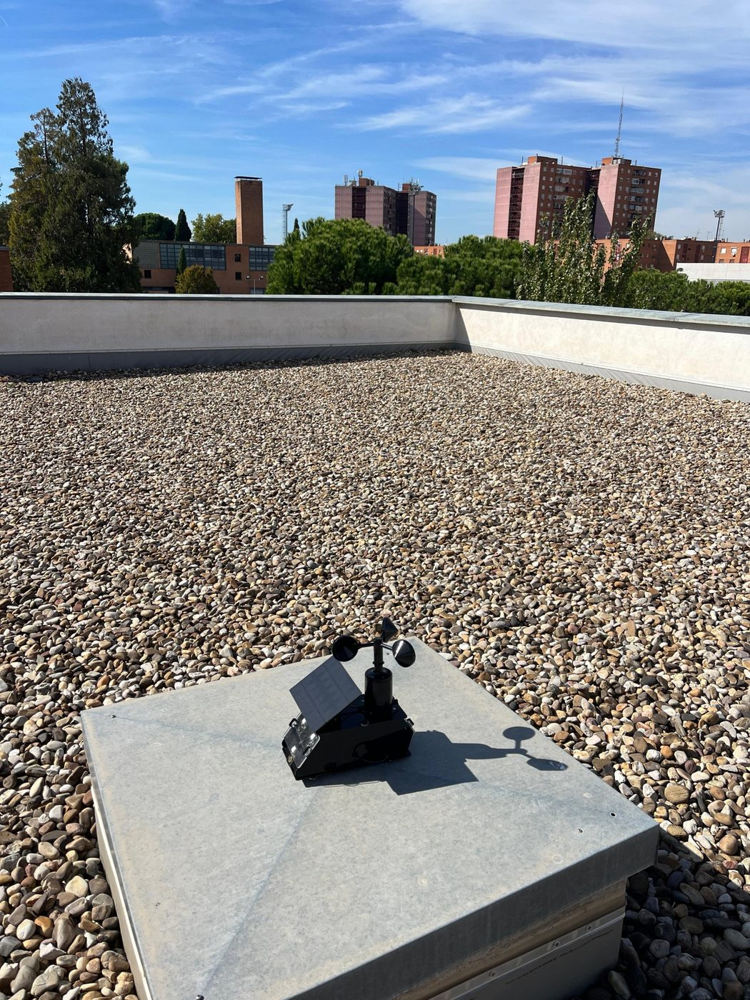
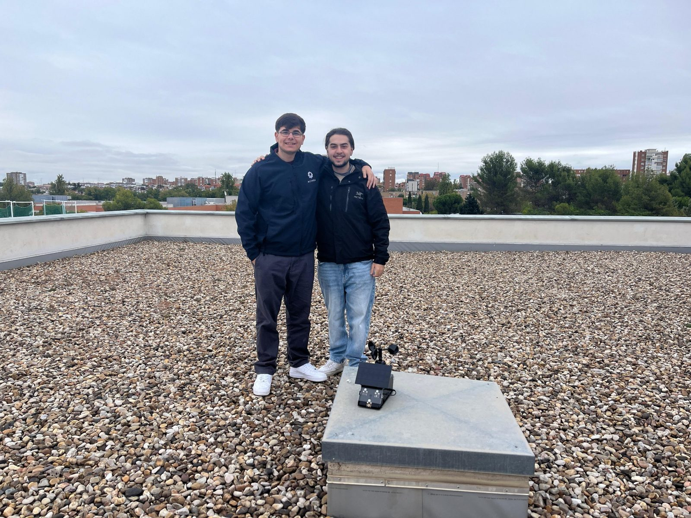

# Estación meteorológica ACEBOTT + SQL Server + Power BI

Este es el proyecto que hicimos Héctor y Marco en el máster de Big Data e IA. La idea era sencilla: coger la estación meteorológica del kit ACEBOTT QE011 (una placa ESP32 con un montón de sensores) y que sus datos no se quedaran en la pantallita, sino que llegaran solos a un servidor, se guardaran en una base de datos y se pudieran analizar en un dashboard.

Al final lo tenemos funcionando de punta a punta: la estación manda una lectura cada minuto, se guarda en SQL Server y la vemos en Power BI casi en tiempo real.



## Qué mide

Temperatura, humedad, presión atmosférica, velocidad del viento, índice UV, partículas PM2.5, luz, lluvia y vibración. Nueve cosas en total.

<p>
  
  
  
</p>

El anemómetro arriba, el panel solar a un lado y la pantalla OLED delante, que enseña los valores y si el último envío ha llegado bien. Dentro van la placa ESP32, las baterías y el resto de sensores.

## Cómo funciona



1. El ESP32 lee los sensores, monta un JSON y lo manda por HTTP a una dirección pública de ngrok.
2. ngrok hace de túnel hasta nuestro servidor (un Windows Server 2025) y le pasa la petición a la API.
3. La API, hecha en Node.js con Express, comprueba la clave y guarda la lectura en SQL Server. La fecha la pone la base de datos, así la estación no necesita reloj.
4. Power BI lee esa misma tabla en modo DirectQuery, así que siempre enseña lo último.

¿Por qué ngrok? Porque en nuestro centro la estación y el servidor estaban en subredes distintas que no se veían entre sí. ngrok abre el túnel desde el servidor hacia fuera y te da una URL fija, sin tener que tocar el router ni abrir puertos.



## Probándolo en la azotea

Una vez funcionaba en clase, subimos la estación a la azotea del centro para dejarla al aire libre. El portátil lo usamos para cargar el programa y ver en directo la web de la API, donde iban entrando las lecturas.

<p>
  
  
</p>

(En la foto del portátil hemos difuminado el código y la barra del navegador porque se veían claves.)

## Qué hay en el repo

```
esp32/esp32_estacion/   programa del ESP32 (Arduino IDE)
servidor/               API en Node.js y el instalador del servidor
sql/                    scripts de la base de datos y la vista para Power BI
powerbi/                proyecto de Power BI (.pbip)
docs/                   documentación técnica (Word) y presentación (PowerPoint)
docs/img/               fotos y el diagrama
```

## Documentación y presentación

Si quieres la versión más formal del proyecto, en `docs/` tienes la [documentación técnica](docs/documentacion_tecnica.docx) en Word, con la arquitectura, los sensores, el servidor y las incidencias, y la [presentación](docs/presentacion.pptx) que usamos para exponerlo en clase, con notas para el orador en cada diapositiva.

## Qué necesitas

**Hardware**
- El kit ACEBOTT QE011 (o un ESP32 con sensores parecidos, cambiando los pines).
- Una WiFi de 2,4 GHz. El ESP32 no ve las de 5 GHz.

**Software**
- Un Windows Server (nosotros usamos el 2025 Standard, pero un Windows normal también vale).
- SQL Server (la edición Express es gratis) y SQL Server Management Studio.
- Node.js LTS. Si no lo tienes, el instalador lo instala.
- Una cuenta gratis de [ngrok](https://ngrok.com) y ngrok instalado y configurado con tu authtoken.
- Arduino IDE con el soporte para ESP32 (el paquete "esp32" de Espressif).
- Power BI Desktop, si quieres el dashboard.

## Cómo montarlo

### 1. El servidor

Copia el contenido de la carpeta `servidor` a `C:\estacion` y haz doble clic en `INSTALAR.bat`. Te va a pedir dos cosas: una contraseña para el usuario de SQL Server y una clave para la API (invéntatela, luego la pones también en el ESP32).

El instalador hace todo esto él solo:

- Configura SQL Server: activa TCP/IP en el puerto 1433 y la autenticación mixta.
- Crea la base de datos `EstacionMeteo`, la tabla de lecturas y un usuario solo para la API.
- Instala las dependencias de Node y deja la API como servicio de Windows con NSSM (lo descarga solo).
- Monta el túnel de ngrok también como servicio.
- Al final manda una lectura de prueba por local y otra por ngrok, y luego la borra.

Si algo falla se para y te dice qué ha pasado. Todo queda apuntado en `C:\estacion\logs\instalacion.log`. Al terminar te enseña la URL que tienes que poner en el ESP32.

Los dos servicios arrancan solos cuando se reinicia el servidor, aunque nadie inicie sesión.

Si prefieres hacerlo a mano, en `sql/` están los scripts por separado y en `servidor/` tienes `config.example.json` y `ngrok.example.yml` como plantilla.

### 2. La estación

1. En Arduino IDE, instala la librería U8g2 desde el gestor de librerías. Las de ACEBOTT (`ACB_DHT11`, `ACB_Ultraviolet_V2`, `ACB_WindCup`, `ACB_PM25` y `ACB_Atmospheric`) vienen con el tutorial del kit.
2. En `esp32/esp32_estacion`, copia `secretos.h.example` como `secretos.h` y rellena tu WiFi, la URL de ngrok (terminada en `/api/lecturas`) y la clave de la API.
3. Selecciona la placa "ESP32 Dev Module" y súbelo.
4. Abre el monitor serie a 115200. Si todo va bien verás `-> 201` en cada envío, y en la pantalla de la estación pondrá "Envio OK".

### 3. El dashboard

1. Ejecuta `sql/03_vista_powerbi.sql` en SSMS. Crea la vista `vw_Lecturas`, que es de donde lee Power BI.
2. Abre `powerbi/EstacionACEBOTT.pbip` con Power BI Desktop en el propio servidor.
3. Si te pide credenciales, elige Windows y "Usar mis credenciales actuales".

Tiene dos páginas: un resumen con el último valor de cada sensor, gráficas del día, el PM2.5 por horas y el UV, y una página con todas las lecturas en tabla. También calcula un par de cosas útiles: si la presión ha bajado más de 3 hPa en 3 horas te avisa de que puede venir mal tiempo, y si dejan de llegar datos durante 15 minutos la estación pasa a "Sin datos".

## Cosas que nos pasaron por el camino

Lo dejamos aquí porque seguramente te encuentres alguna:

- **Error 502 de ngrok (ERR_NGROK_8012).** ngrok buscaba la API en `localhost`, que se resolvía por IPv6, y la API solo escuchaba en IPv4. Lo arreglamos apuntando el túnel a `127.0.0.1:3000`.
- **El ESP32 no podía mandar por HTTPS.** La conexión con ngrok se cortaba en pleno saludo TLS (`SSL - The connection indicated an EOF`), y lo curioso es que desde un PC de la misma red sí funcionaba. Creemos que era el firewall del centro, pero no lo pudimos confirmar. Al final mandamos por HTTP.
- **Código -1 con una URL http://.** Usábamos `http.begin(client, URL)` con un `WiFiClientSecure`, que intenta cifrar. Con HTTP hay que usar `http.begin(URL)` sin cliente.
- **Temperatura sin decimales.** En el ejemplo del kit las variables eran `int` y se comían los decimales. Las pasamos a `float`.
- **Vibración al revés.** El sensor da 0 cuando vibra. Invertimos la lectura para que 1 signifique que hay vibración.
- **Un 201 que parecía un error.** No lo es: 201 significa "Created", o sea, que la lectura se ha guardado bien.

## Lo que tiene pendiente

- Los datos y la clave viajan sin cifrar por el tema del HTTPS. Para algo de clase nos vale, pero no lo usaríamos así en serio.
- Dependemos del plan gratis de ngrok: 20.000 peticiones al mes. Mandando cada minuto se acaba en unas dos semanas, así que para dejarla funcionando más tiempo hay que subir el intervalo a 5 minutos (se cambia en `INTERVALO_ENVIO`).
- El DHT11 solo mide la humedad de 1 en 1 %, y la vibración solo se registra en el instante en que se manda la lectura.
- El PM2.5 nos ha dado algunos valores disparatados (miles de microgramos). Hay que revisar qué está leyendo exactamente ese sensor.

Ideas para seguir: volver a HTTPS, poner sensores más precisos (un DHT22 o un BME280), avisos automáticos cuando llueva o el UV esté alto, y usar el servo del kit para que el panel solar siga al sol.

## Licencia

Código abierto con licencia MIT: úsalo, cópialo y cámbialo como quieras, solo mantén el aviso de la licencia. Lo tienes en [LICENSE](LICENSE).

## Autores

Héctor ([@hectormtudela](https://github.com/hectormtudela)) y Marco ([@MartinezDelAlamoMarco](https://github.com/MartinezDelAlamoMarco)).


